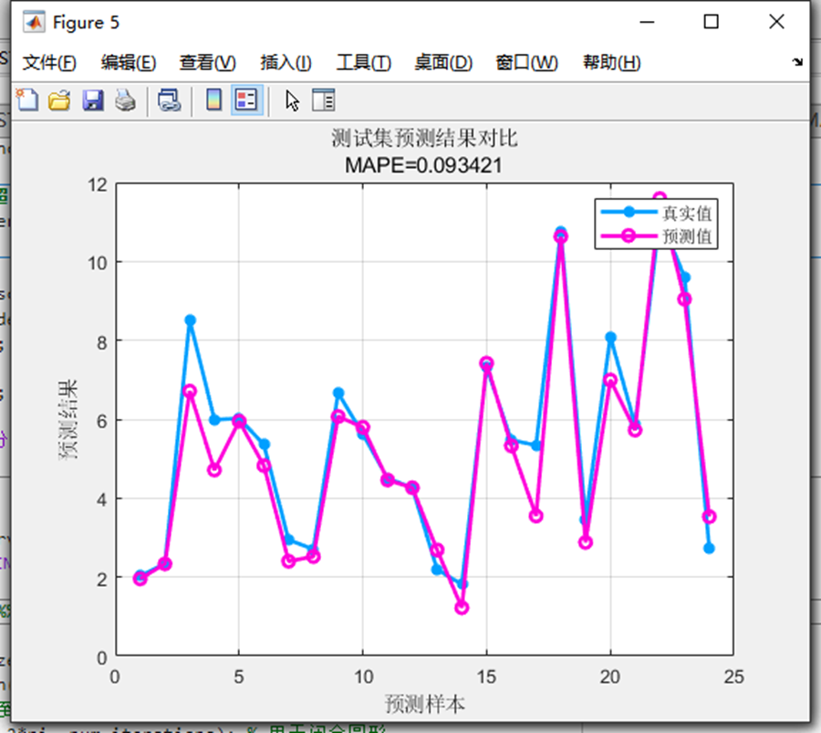
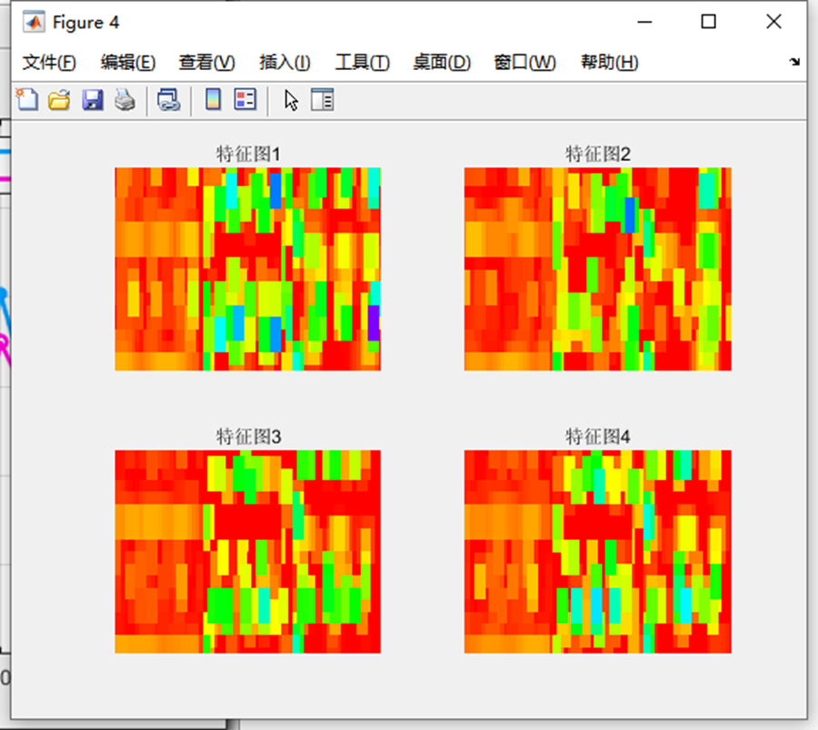
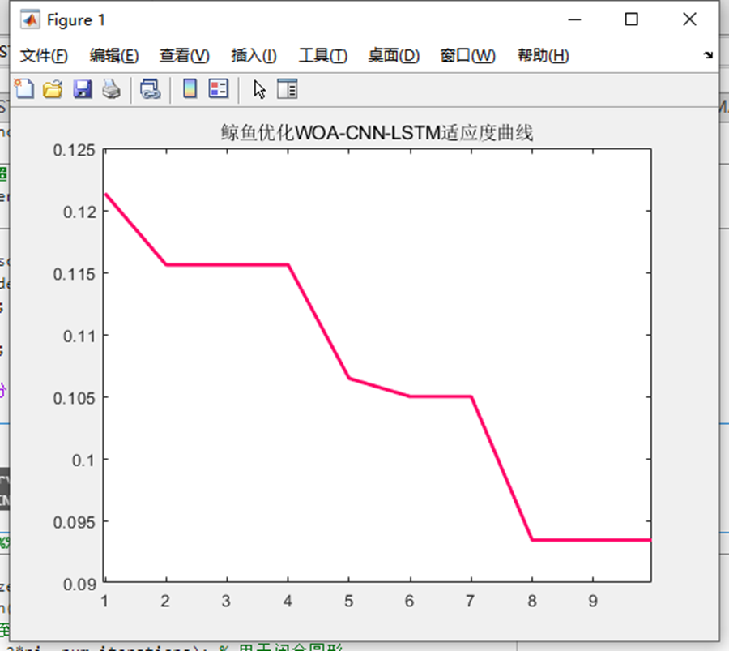
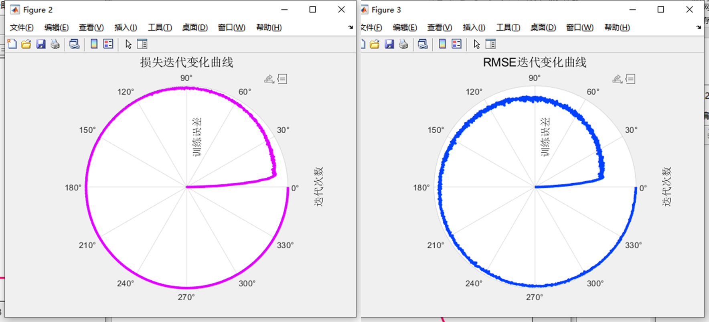

# Optimization of hyperparameters for WOA-CNN-LSTM multi-feature backpropagation model in MATLAB, including feature visualization and data imported from Excel. Run directly.

WOA-CNN-LSTM is a forward-looking 24-step multivariate time series regression prediction algorithm based on the Whale Optimization Algorithm (WOA), Convolutional Neural Networks (CNN), and Long Short-Term Memory networks (LSTM). It is suitable for platforms: Matlab 2022b and above.
WOA (Whale Optimization Algorithm) is an heuristic optimization algorithm used to find the optimal hyperparameters combination to improve the performance of deep learning models. For the CNN-LSTM regression prediction model, adjusting hyperparameters such as the size of CNN convolutional kernels, number of LSTM neurons, and learning rate can significantly impact model performance.
Convolutional Kernel Size: The size of the convolutional kernel determines the receptive field of the CNN network, i.e., the spatial range each convolutional layer can capture. Selecting different sizes of convolutional kernels can affect the model's feature extraction capability. Smaller convolutional kernels can capture finer-grained features, while larger ones can capture more macro features.
Number of LSTM Neurons: LSTM is a type of recurrent neural network suitable for sequence data, with the number of LSTM neurons determining the complexity and memory capacity of the model. More LSTM neurons can enhance the model's learning ability but may lead to overfitting.
Learning Rate: The learning rate is a key hyperparameter in training deep learning models, controlling the step size of each parameter update. A large learning rate may cause model instability and divergence, while a small learning rate may result in slow training or local minima.
WOA is a global optimization algorithm that helps find the global optimal hyperparameter combination. It does not rely on gradient information, making it suitable for non-convex problems and highly nonlinear objective functions. WOA can automatically adjust hyperparameters, reducing the manual workload of hyperparameter tuning and improving the efficiency of hyperparameter search. Using WOA for hyperparameter optimization of CNN-LSTM regression prediction models can help you find the best hyperparameter configuration, enhancing model performance. It is an effective method, especially suitable for complex deep learning models and large-scale datasets.
WOA-CNN-LSTM multivariate regression prediction program function:
1. Input multiple variable features, output single sequence variables, input the features of the previous day to achieve prediction for the next day, with a lead-time of 24 steps.
2. Optimize the learning rate, convolutional kernel size, and number of neurons through WOA optimization algorithm, aiming to minimize MAPE as the objective function.
3. Provide polar coordinate plots of loss and RMSE iteration changes; network feature visualization graphs; test comparison graphs; fitness curve (if the initial accuracy is the highest, then the fitness curve is a horizontal line).
4. Provide results display for MAPE, RMSE, MAE, etc.
Applicable fields:
Applications include wind speed forecasting, photovoltaic power forecasting, power generation forecasting, and carbon price forecasting.
Predicted vs. actual values comparison:
\n        \n      Convolutional Feature Visualization:
\n Adaptation curve:
\n        \n      MSE and loss changes in polar representation: (inner circle with larger error, outer circle with smaller error)
  
\n        \n  

## Images

<!-- PAYMENT_BLOCK -->

## Get this dataset

- Payment link (Stripe): [Buy now](https://buy.stripe.com/3cs8yP7sY87d0vu9AB)
- Payment QR code: 

<!-- /PAYMENT_BLOCK -->
